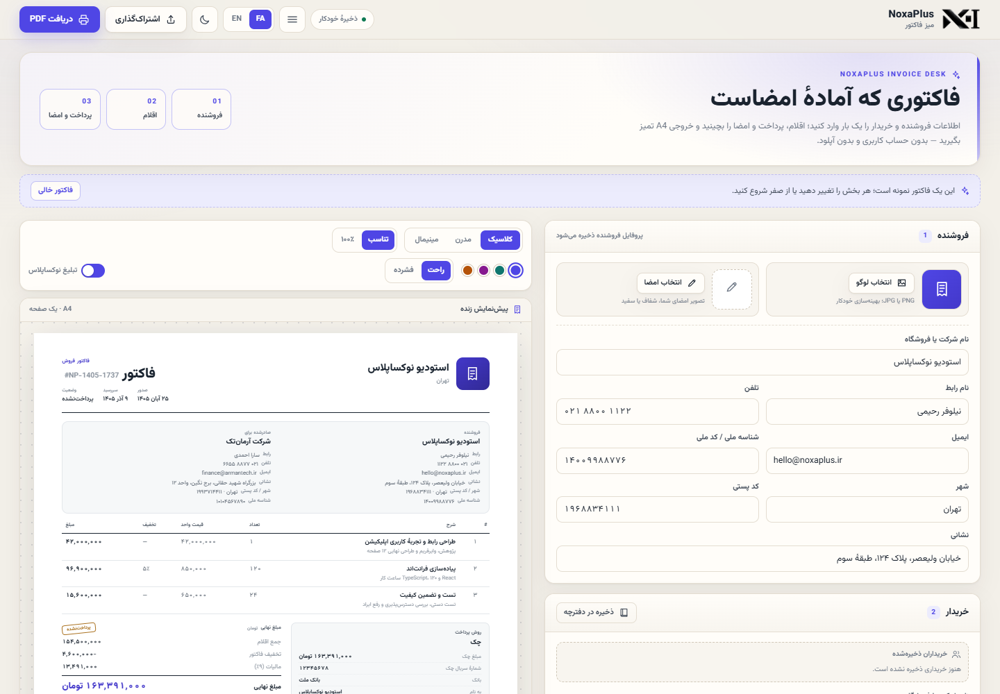
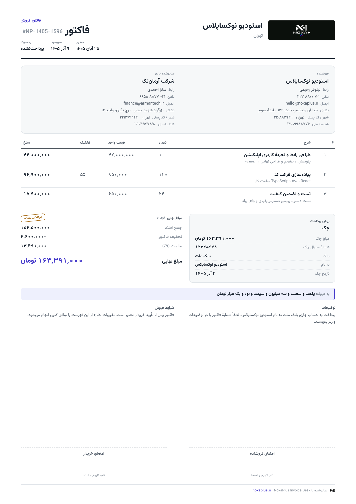
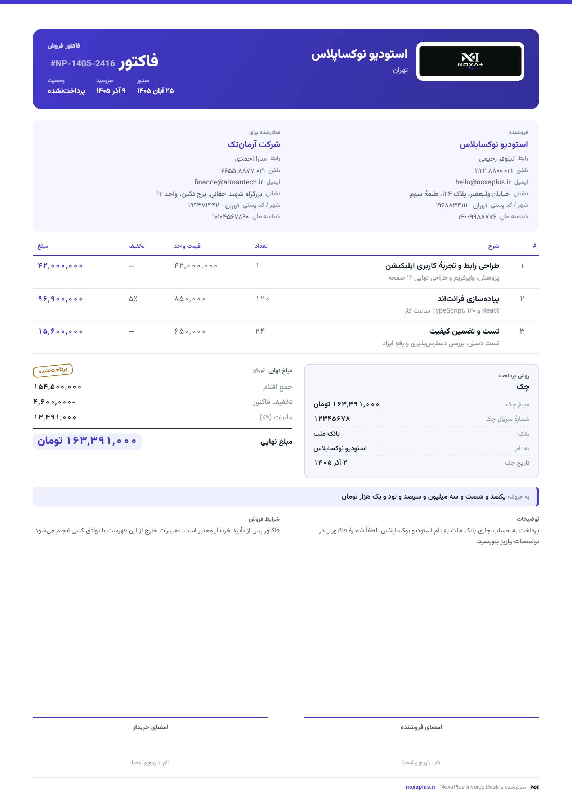
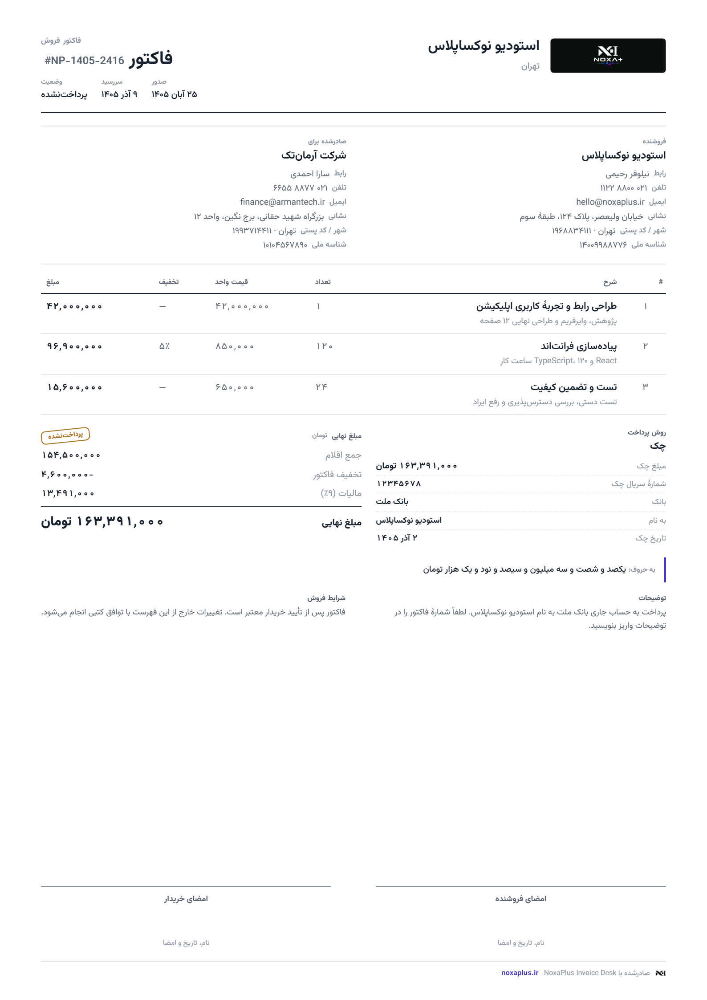
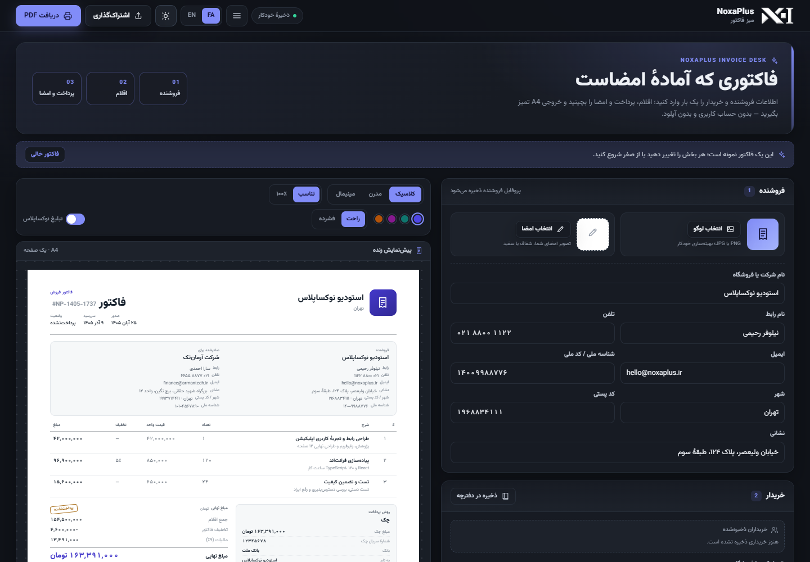
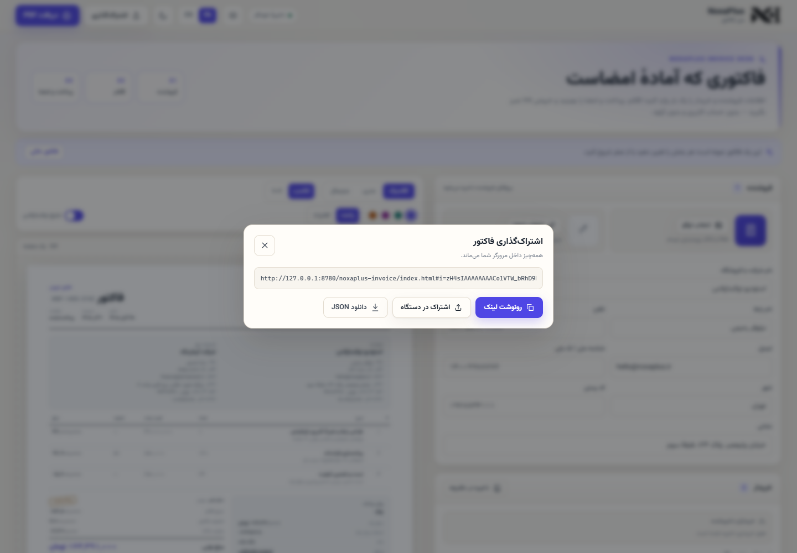
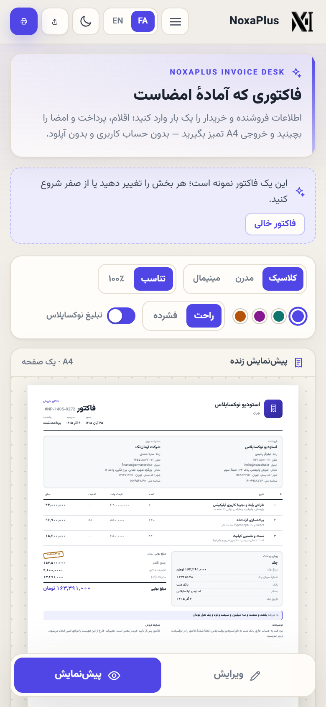

<p align="center"></p>

# NoxaPlus Invoice Desk

**An invoice that’s ready to sign.**

NoxaPlus Invoice Desk is a private, browser-only sales-invoice maker. It keeps the seller and buyer details in one place, builds the line items and totals while you type, handles cash, cheque and installment payments, and prints a clean A4 page with logos, signatures and a payment schedule — no account, no upload, no server.

**Live demo:** [noxaplus-star.github.io/noxaplus-invoice](https://noxaplus-star.github.io/noxaplus-invoice/)

[](https://noxaplus-star.github.io/noxaplus-invoice/)
[](index.html)
[](LICENSE)
[](https://nodejs.org/)

[GitHub repository](https://github.com/noxaplus-star/noxaplus-invoice) · [NoxaPlus](https://www.noxaplus.ir)



## Why this exists

Most invoice tools ask for an email address before they show you a blank page, then hide the printed result behind a paywall. Invoice Desk is built around the paper instead: a live A4 preview, real page count, real margins, and a PDF that looks exactly like the preview. Everything runs in your browser, in Persian or English, with or without a connection.

It also treats an invoice as a document that gets **signed**, not a receipt that gets emailed. The seller and buyer blocks, the cheque details, the installment schedule and the signature lines are all part of the same page.

## The invoice page



## What you can build

- **Complete branding:** company or store name, contact person, phone, email, national/tax ID, city, postal code, address — plus a logo and a signature image that are resized and optimized locally.
- **A real buyer record:** the same complete fields for the buyer, with an address book for repeat customers.
- **Line items with math:** title, description, quantity, unit price and per-line discount; reorder rows; line totals update instantly.
- **Invoice-level money controls:** discount, tax rate, shipping, previous balance, paid amount and balance; subtotal and grand total always agree.
- **Three payment methods:** cash (with a “full amount” shortcut), cheque (amount, serial, bank, holder, due date), and installments (down payment, count, interval, first due date) with an automatically generated schedule.
- **Automatic amounts in words:** the total is written out in Persian or English, including the correct currency.
- **Document identity:** auto-generated invoice numbers (`NP-1405-0001` style), issue date, due date, and draft / unpaid / paid statuses with a stamp on the page.
- **Three A4 templates:** Classic, Modern and Minimal, each in cozy or compact density.
- **Four accents and a dark interface:** the app chrome changes; the printed invoice stays white and ink-dark for legibility.
- **Bilingual by design:** فارسی / English with RTL and LTR layouts, Jalali or Gregorian dates, localized digits and Toman, Rial, USD, EUR or AED.
- **Share and export:** a compressed share link that carries the whole invoice in the URL, native device sharing where supported, and portable JSON files.
- **Print-perfect PDF:** the app UI disappears, the sheet is exactly 210×297 mm, the demo fits on one page, and the browser’s print dialog produces a clean document.

## Ten thoughtful extras

These are the ideas beyond the usual form-and-preview loop:

1. **Readiness reviewer.** Eight checks — seller, buyer, items, pricing, dates, payment, terms and signature — with a score ring and a plain reason for every missing point.
2. **Installment schedule that writes itself.** Enter a down payment, a count and an interval; the editor and the printed invoice both receive a dated schedule with a corrected final row.
3. **Amount in words in both languages.** Persian and English number spelling is generated locally, so “one hundred sixty-three million…” never has to be typed by hand.
4. **Saved buyer address book.** Keep up to twelve buyers and refill the whole block with one click; edit before saving and the book upserts instead of duplicating.
5. **Seller profile autosave.** The company block, logo and signature are remembered separately from the current invoice, so the next invoice starts branded.
6. **Measured page count.** The preview badge reads the rendered sheet height, not a guess; “A4 · one page” means one page in print too.
7. **Status stamps and hints.** Draft, unpaid and paid change the stamp on the invoice and the guidance in the editor, so nobody mistakes a quote for a settled document.
8. **Share link in the URL.** The invoice is compressed (gzip → base64url) into the hash. No database and no account; if a large logo would make the link unwieldy, the link is built without images with a clear warning.
9. **Duplicate and portable JSON.** Duplicate an invoice to start the next month, or export/import a complete document for backup and hand-off.
10. **Offline and single-file.** A service worker makes the hosted app installable, and `index.html` at the repository root is a complete standalone build with fonts, logo and styles inlined; it opens straight from disk.

## Three templates

| Classic | Modern | Minimal |
| --- | --- | --- |
|  |  |  |

Every template supports cozy/compact density, all four accents, both languages and the same payment blocks.

## Payment methods

| Method | On the page |
| --- | --- |
| **Cash** | Paid amount, remaining balance, “pay full amount” shortcut |
| **Cheque** | Amount, serial number, bank, holder (“in the name of”), due date |
| **Installments** | Down payment, number of installments, interval in days, first due date, full schedule table |

The payment block also prints the status line (“settled”, “due”, “draft”) so the customer sees the same state as the seller.

## Languages and themes

| Light | Dark (English UI) |
| --- | --- |
|  |  |

The interface is translated end to end. The untouched demo is translated in place when you switch languages; edited text is preserved. The printed sheet is always white paper with dark ink, in both themes.

## Sharing and mobile



On phones the studio switches to Edit / Preview tabs. The preview fits the A4 sheet to the screen, the editor becomes single-column, and the bottom tab bar keeps both halves one tap away.

<p align="center"></p>

## Privacy

There is no backend, no analytics, and no external font, icon or image request. Logo, signature, invoice, buyers and preferences stay in the browser. See [docs/privacy.md](docs/privacy.md) for the exact storage keys and share-link behavior.

## Development

```bash
npm install        # install dependencies
npm run dev        # local studio with HMR
npm test           # 15 unit tests (totals, payments, words, normalization, share)
npm run build      # typecheck, production build, standalone index.html
npm run preview    # preview the production build
```

The build writes `dist/` for GitHub Pages and a self-contained `index.html` at the repository root.

### Project structure

```text
app/index.html          app shell and document metadata
src/App.tsx             studio layout, state, autosave, share, print
src/components/         invoice sheet, party fields, items, payment, review, form controls
src/lib/model.ts        invoice factory, totals, installment schedule, checks, normalization
src/lib/money.ts        number spelling, currency and date formatting
src/lib/share.ts        compressed share links (#i=...)
src/lib/storage.ts      local drafts, seller profile, buyer book
src/i18n.ts             Persian and English strings, statuses, currencies
src/styles.css          interface design system and A4 invoice templates
scripts/sync-standalone.mjs  inlines the build and writes the standalone index.html
```

### Printing

1. Click **Get PDF** (or use the browser’s Print command).
2. Choose **Save as PDF**, paper **A4**, margins **None**, and enable **Background graphics** for the accents.
3. The app hides its own UI and prints only the invoice sheet.

## License

MIT © NoxaPlus. Third-party notices are included in [THIRD-PARTY-LICENSES.txt](THIRD-PARTY-LICENSES.txt).
